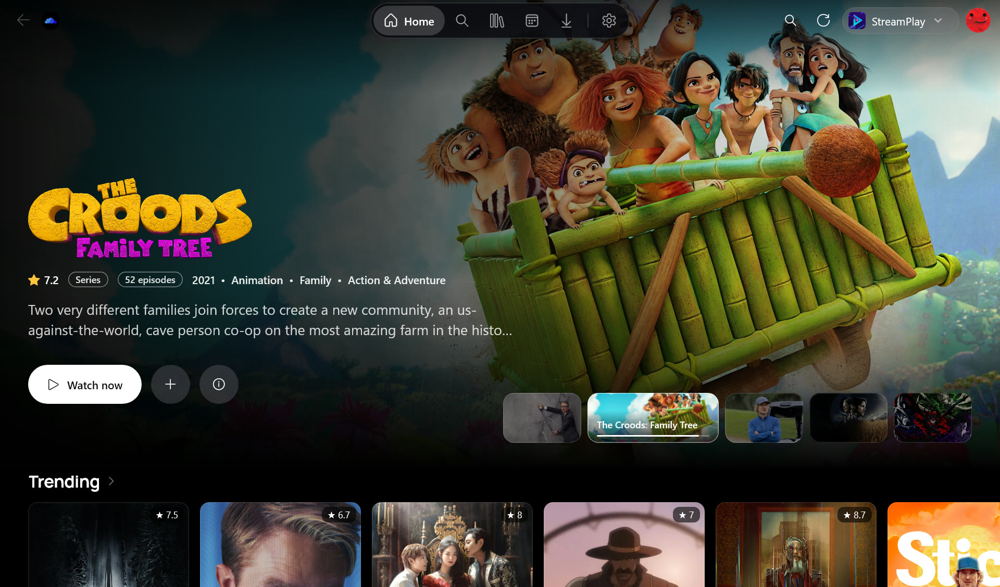
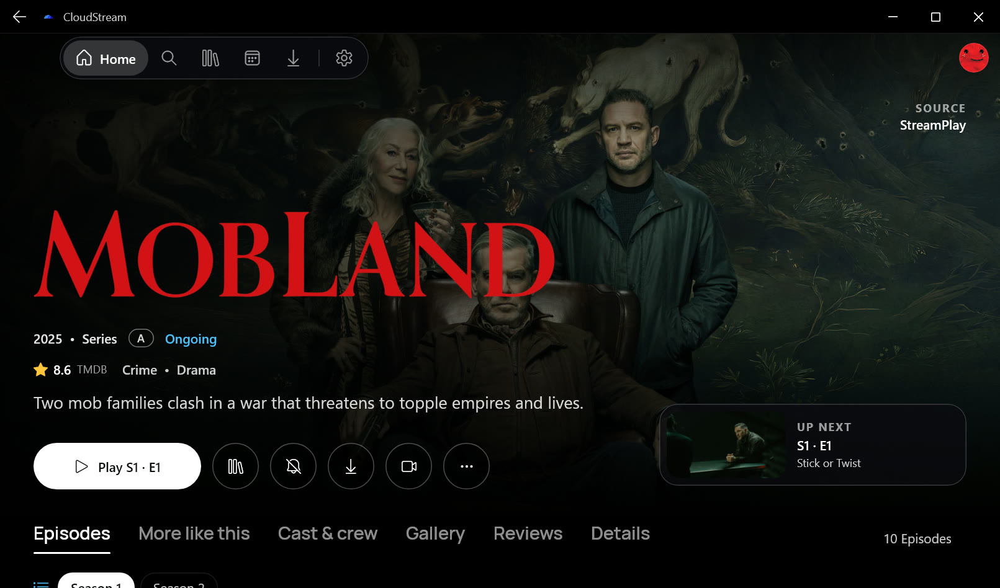
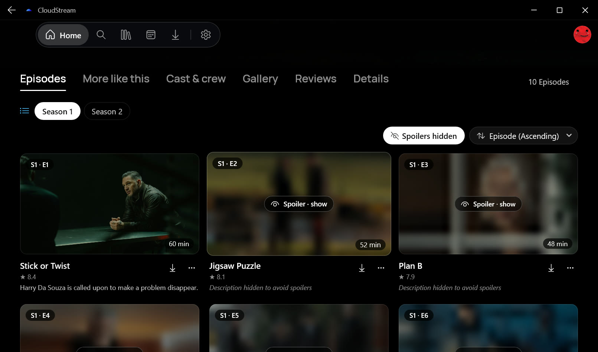
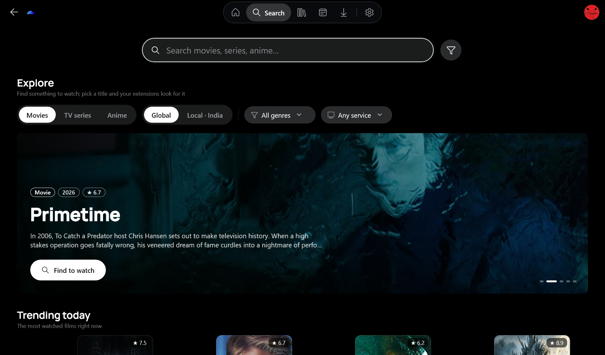
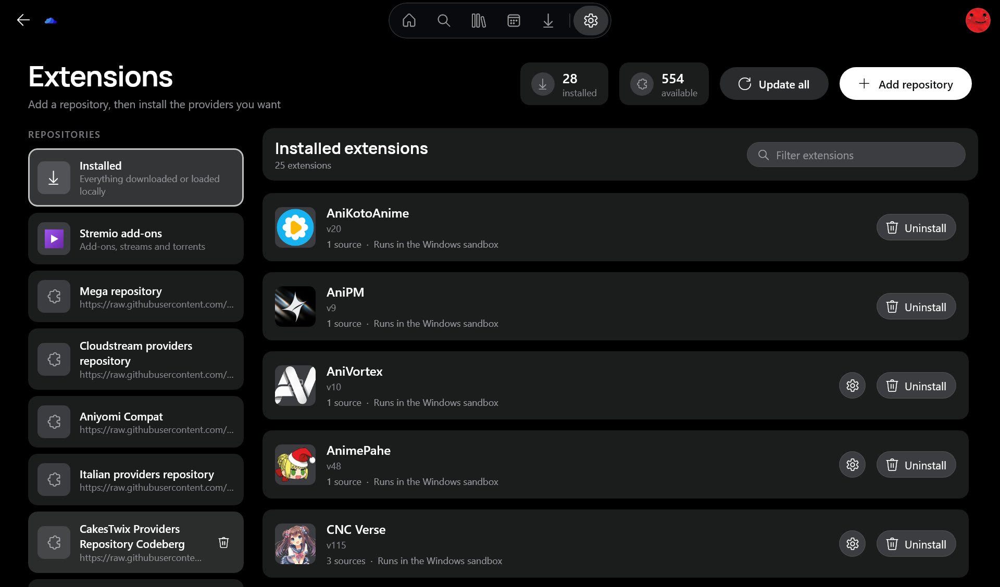
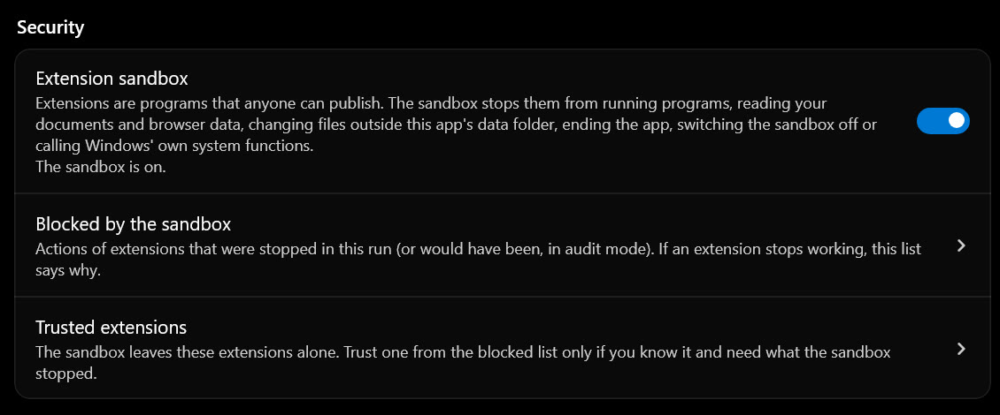

<p align="center">
  
</p>

<h1 align="center">CloudStream for Windows</h1>

<p align="center">Movies, series, anime and live TV in a native Windows 10 & 11 desktop app.<br>
Runs your CloudStream extensions on the desktop, with a real <code>mpv</code> player and a sandbox around every extension.</p>

<p align="center">
  <a href="../../releases/latest"></a>
  <a href="https://t.me/cs3d_official"></a>
  <a href="https://discord.gg/u82JU5JDM"></a>
</p>

<p align="center">
  <a href="../../releases"></a>
  <a href="../../actions/workflows/ci.yml"></a>
  <a href="LICENSE"></a>
</p>

<p align="center">
  <a href="#download">Download</a> ·
  <a href="#extension-sandbox">Extension sandbox</a> ·
  <a href="#getting-started">Getting started</a> ·
  <a href="#help">Help</a> ·
  <a href="#build-from-source">Build</a> ·
  <a href="#credits">Credits</a>
</p>

> [!NOTE]
> **A personal project.** I am not a developer. This app was made entirely for my own needs, using vibe coding (building with AI). It is shared as is: expect bugs, glitches and rough edges. Issues and pull requests are welcome, but there is no guarantee of support or fixes.

---

<p align="center">
  
</p>

<table>
  <tr>
    <td width="50%"><br><sub><b>Title pages</b> · artwork, ratings, Up Next, cast, gallery and reviews</sub></td>
    <td width="50%"><br><sub><b>Episodes</b> · stills and details, with spoilers hidden until you get there</sub></td>
  </tr>
  <tr>
    <td width="50%"><br><sub><b>Explore</b> · global and local charts, by genre and streaming service</sub></td>
    <td width="50%"><br><sub><b>Extensions</b> · add a repository, install what you want, pick a source on Home</sub></td>
  </tr>
</table>

<sub>Screenshots use the <a href="https://github.com/phisher98/cloudstream-extensions-phisher">StreamPlay</a> extension. CloudStream for Windows itself ships with no extensions and no content.</sub>

---

## Download

Open **[Releases](../../releases/latest)** and pick a package for **Windows 10 or 11 (64-bit)**:

| Package | File | Best for |
| :--- | :--- | :--- |
| **Setup** *(recommended)* | `CloudStream-…-windows-x64-setup.exe` | Per-user install, no admin rights, Start menu and desktop shortcuts, in-app updates. Over an old MSI install it replaces it in the same folder and keeps your settings. |
| **MSI** | `CloudStream-…-windows-x64.msi` | Standard Windows Installer package (per-user, no script actions). |
| **Portable ZIP** | `CloudStream-…-windows-x64-portable.zip` | Unpack anywhere and run `CloudStream.exe`. Settings, extensions and caches stay in the `data/` folder next to it. |

**Updates.** The app checks the GitHub releases a few seconds after it starts, then every few hours, and never while a video plays. A new version shows as a banner at the bottom of the window with its size and release notes; **Update** downloads the package that matches how you installed it (setup, MSI or portable zip) with a progress bar, checks it against the SHA-256 GitHub lists for the file, and installs it when you click *Restart & update*; your repositories, extensions, accounts and history are kept. A failed download says why and offers a retry, a version can be skipped, and `Settings → Updates` has the Stable or Beta channel and the automatic check. Extensions update themselves at every start (`Settings → Extensions and sources`).

> [!NOTE]
> The installer is not signed with a paid certificate yet, so Windows SmartScreen may say *"Windows protected your PC"* on first run: **More info → Run anyway**. See **[SECURITY.md](SECURITY.md)** for checksums and how the installers are built.

## What you get

- **A real player.** `libmpv` with hardware decoding, HLS and DASH, Picture-in-Picture, audio passthrough, subtitles from files, embedded tracks and online search (OpenSubtitles, SubDL), and optional Anime4K / FSR upscaling.
- **Your extensions.** Runs CloudStream `.cs3` extensions natively on the JVM, no emulator. Also Stremio add-ons and torrents (TorrServer is downloaded only when you turn it on).
- **Explore and title pages.** TMDB and AniList charts (global or local), cast and crew, trailers, episode stills, spoiler protection, reviews.
- **Live TV.** HLS and ClearKey DASH channels with a seek bar that follows each channel's own time window.
- **Sync.** AniList, MyAnimeList and Simkl, one Library for all of them.
- **Made for the desktop.** 14 themes (and a Netflix-style interface), 10 languages, a Low-end PC mode and a safe-graphics start for old graphics drivers.

## Extension sandbox

Extensions are programs that **anyone can publish**. CloudStream for Windows does not trust them: every extension runs in a sandbox that is **on by default** (`Settings → Network and security → Sandbox for extensions`, one switch). They run in a separate process that **Windows itself locks down** (an AppContainer in a job object): it cannot read your documents or browser data, start programs, change files outside its own folder or reach your home network, and it keeps the internet, so sources work as before. Settings pages, video interceptors and the browser pages an extension needs (Cloudflare checks) are handled by the app on its behalf. Only an extension you mark **Trust**, and every extension on a PC where Windows cannot start the sandbox, runs in the app, under a Java guard described below.

<p align="center">
  
</p>

| An extension is **stopped** from… | It **keeps** |
| :--- | :--- |
| running programs, also by asking Windows to "open" an executable, a script or a shortcut | the network |
| reading your documents, downloads, browser data or keys, and changing or deleting files outside the app's own data and temp folders (so no startup entries) | everything it needs to find and resolve sources |
| ending the app, switching the sandbox off, loading native libraries or its own class loaders, calling Windows system functions | its own settings page and web checks (Cloudflare) while you use it |
| taking screenshots, watching the keyboard, reading the clipboard, changing the app's proxy, cookie or certificate handling | |

- **You can see it working.** When something is stopped, the extension gets an error, a toast names the extension and the action, and **Blocked by the sandbox** lists it, so a source that breaks can be understood.
- **You stay in charge.** An extension you know and need can be marked **Trust** from that list; **Trusted extensions** takes it back. The popups of an extension you are not using (donation or news windows) are not shown at all, and its Cloudflare check windows wait until you use it.
- **How it works.** For an extension in the Windows sandbox, search, title pages and links travel over a pipe and only plain data comes back; a browser view it builds is a page of the app's browser (opened for http and https addresses only, shown to you in a window of the app, with a Cancel button, only while you use that extension), and its settings page opens in the app on your click. For an extension that runs in the app, the launcher starts the JVM with a Java `SecurityManager` that only acts when extension code is on the call stack; the app's own work passes at once. The few things the app does for an extension on purpose (opening a link, copying text) go through a gate that checks them first. `-Dcloudstream.sandbox=audit` only logs what would be stopped.
- **What it is not.** It is not a virtual machine and not a barrier against code written to defeat this very sandbox. It makes the usual attacks fail and shows what an extension tries. Add only repositories you trust and keep Windows Defender on. Details and reporting: **[SECURITY.md](SECURITY.md)**.

## Getting started

1. **Add a repository** (`Extensions → Add repository`) and install the extensions you want, or enable a Stremio add-on (`Settings → Stremio & torrents`). Nothing is pre-installed.
2. Pick a **source** at the top right of Home, or just **search**, choose a title and press **Play**.
3. *Optional:* connect AniList, MyAnimeList or Simkl in `Settings → Accounts & sync`.

## Help

<details>
<summary><b>The video stutters or drops frames</b></summary>

In the player's menu set **Upscaling** to **Off** or **Sharp**; try **Native GPU player** in `Settings → Appearance`. A built-in governor already steps the rendering down when the processor falls behind.

</details>

<details>
<summary><b>The window flickers, or the app is slow on an old PC</b></summary>

`Settings → General → Performance`: **Low-end PC mode** (automatic) and **Graphics renderer** (try OpenGL, then Software; restart afterwards). If the screen is too broken to reach Settings, start **CloudStream (safe graphics)** from the Start menu (the portable folder has `CloudStream (safe graphics).cmd`) or run `CloudStream.exe --safe-graphics`. Update the graphics driver too.

</details>

<details>
<summary><b>A source or live channel does not play (but works on my phone)</b></summary>

Many hosts block VPNs, datacenter IPs and Cloudflare WARP. Turn the VPN / WARP off and try again, or use **Reload sources** in the player's Sources menu.

</details>

<details>
<summary><b>A site's Cloudflare check does not open</b></summary>

The check window of an extension opens when you use that extension (it is Home, an open title page or a search). If it was asked for earlier it is held for a few minutes and shown, or passed in the background, when you switch to it. `Settings → General → Pass Cloudflare checks` turns the windows off for good.

</details>

<details>
<summary><b>Where are my settings and extensions?</b></summary>

Installed app: `%APPDATA%\CloudStream` (`Settings → About → App data folder`), with a safety mirror in `%LOCALAPPDATA%\CloudStream-keep`. Portable: the `data/` folder next to `CloudStream.exe`. Back up or restore everything in `Settings → Updates & backup`.

</details>

**Reporting a bug:** open a [GitHub issue](../../issues/new/choose) or write on [Discord](https://discord.gg/u82JU5JDM) / [Telegram](https://t.me/cs3d_official), with the output of **Settings → About → Copy diagnostics** (passwords and tokens are masked).

## Build from source

Requires **JDK 21** and **[Git LFS](https://git-lfs.com)** (`git lfs install` before cloning).

```powershell
.\gradlew.bat :app:runDev           # run from source
.\gradlew.bat :app:test             # unit tests
.\gradlew.bat :app:portableDist     # portable app in dist/CloudStream-Portable
.\gradlew.bat :app:portableZip      # release zip in dist/release
.\gradlew.bat :app:installerMsi     # MSI in dist/release (needs WiX Toolset 3.x)
```

The engine in `library/`, `shared/` and `android/` follows upstream CloudStream **4.8** at commit
[`d9c55e2`](https://github.com/recloudstream/cloudstream/commit/d9c55e2e5b020dde8e28c12a3e7802df962265ac) (2026-10-15); the same commit is linked in the repository as the [`cloudstream-reference`](cloudstream-reference) submodule (full hash in [`UPSTREAM_COMMIT`](UPSTREAM_COMMIT)); you do not need to check it out to build.
See **[CONTRIBUTING.md](CONTRIBUTING.md)** for the architecture and dev tools, and **[CHANGELOG.md](CHANGELOG.md)** for every release.

## Credits

| | |
| :--- | :--- |
| **[CloudStream](https://github.com/recloudstream/cloudstream)** (GPL-3.0) | The engine this app is built on: the extension API, the repository and plugin format, the sync providers and the Android app this one mirrors. Pinned at upstream commit [`d9c55e2`](https://github.com/recloudstream/cloudstream/commit/d9c55e2e5b020dde8e28c12a3e7802df962265ac). Thanks to the CloudStream team and to every extension developer. CloudStream for Windows is an independent desktop port, not an official release. |
| **[Ayu · CS3 Desktop Client (unofficial)](https://github.com/errorcode26/CS3-desktop-client-unofficial)** by errorcode26 | The UI ideas: the floating glass player and its motion, the cast and crew rows, the calmer art-first look of the title pages, and Stremio add-ons beside the extensions. Only the look and the ideas were taken; the code of this app is its own. |

**Built with** [mpv](https://mpv.io) and [FFmpeg](https://ffmpeg.org) (player), [Compose Multiplatform](https://github.com/JetBrains/compose-multiplatform) and [Skia](https://skia.org) (UI), [Anime4K](https://github.com/bloc97/Anime4K) (MIT) and FSR / CAS (AMD, MIT) shaders, [TorrServer](https://github.com/YouROK/TorrServer) (GPL-3.0), the [Manrope](https://github.com/sharanda/manrope) typeface (OFL 1.1). Data from [TMDB](https://www.themoviedb.org), [AniList](https://anilist.co), [MyAnimeList](https://myanimelist.net), [Simkl](https://simkl.com), [OpenSubtitles](https://www.opensubtitles.com) and [SubDL](https://subdl.com). This product uses the TMDB API but is not endorsed or certified by TMDB. The characters and footage of the animated profile pictures belong to their owners (`app/src/main/resources/avatars/LICENSE.txt`).

## Support

Free, open-source and ad-free. A star on GitHub or a small donation keeps it going: [Razorpay](https://razorpay.me/@lelouch11) (UPI and cards, India) or [Buy Me a Coffee](https://buymeacoffee.com/lelouchcodes11) (international). News and releases on [Telegram](https://t.me/cs3d_official), talk and help on [Discord](https://discord.gg/u82JU5JDM).

## Disclaimer & license

CloudStream for Windows contains **no extensions, no Stremio add-ons and no media content**. Extensions and add-ons are made by independent third parties and added at your own discretion; you are responsible for what you access. Not affiliated with Stremio. Torrent streaming shares data peer-to-peer and shows your IP address to the swarm unless you use a VPN.

<p align="center"><sub>Licensed under <a href="LICENSE">GPL-3.0</a>. Built on the <a href="https://github.com/recloudstream/cloudstream">CloudStream</a> engine.</sub></p>
