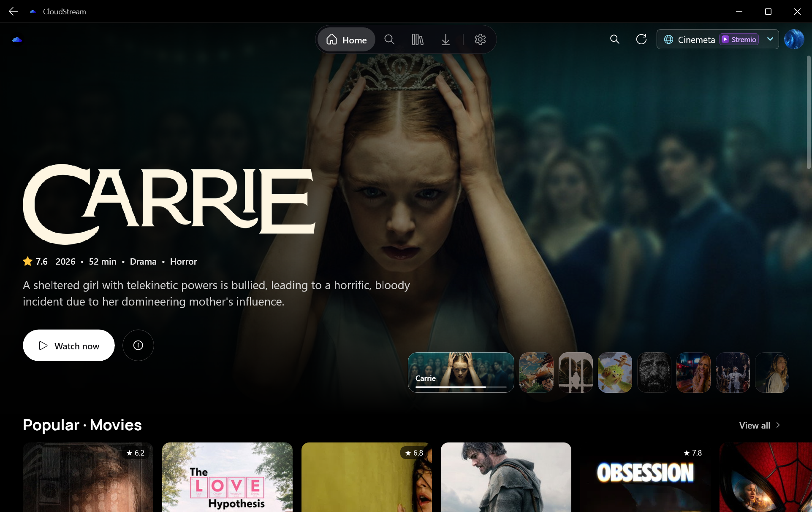
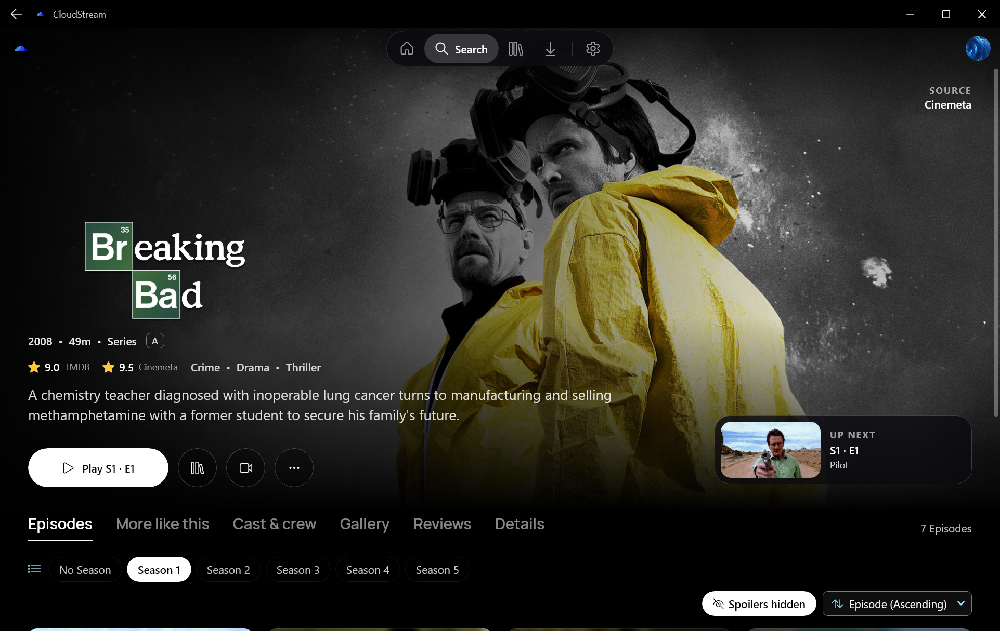
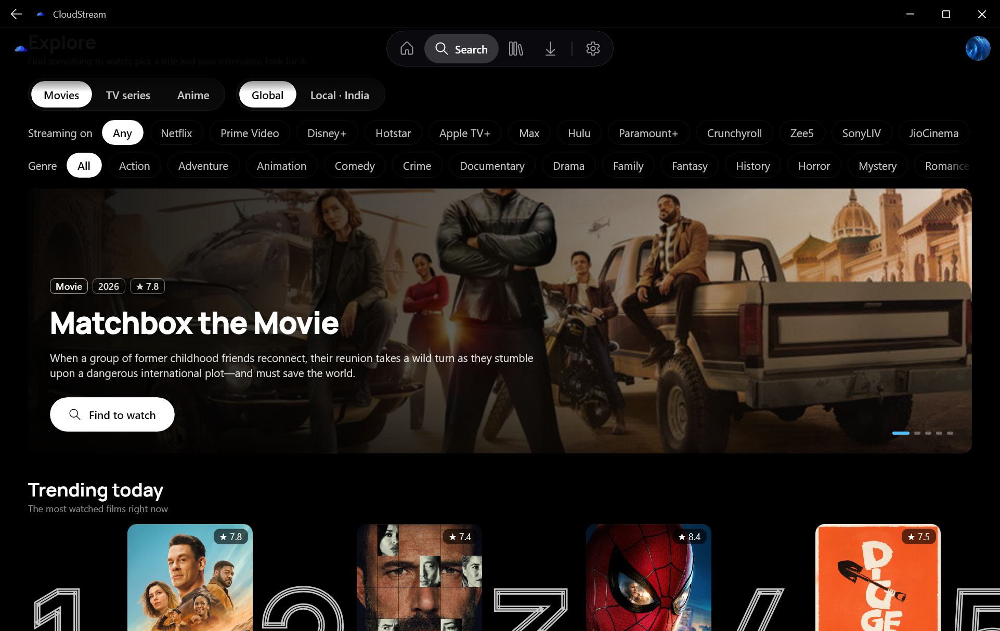

<p align="center">
  
</p>

<h1 align="center">CloudStream for Windows</h1>

<h3 align="center">Movies, series, anime and live TV on your PC — in a native Windows 10 & 11 desktop app.</h3>

<p align="center">
  <a href="../../releases/latest"></a>
  <a href="https://t.me/cs3d_official"></a>
  <a href="https://discord.gg/u82JU5JDM"></a>
  <a href="https://razorpay.me/@lelouch11"></a>
</p>

<p align="center">
  <a href="../../releases"></a>
  <a href="../../releases"></a>
  <a href="../../actions/workflows/ci.yml"></a>
  <a href="LICENSE"></a>
  
</p>

<p align="center">
  <a href="#-preview">Preview</a> ·
  <a href="#️-download--install">Download</a> ·
  <a href="#-join-the-community">Community</a> ·
  <a href="#-what-you-get">Features</a> ·
  <a href="#-first-steps">First Steps</a> ·
  <a href="#-help--faq">Help & FAQ</a> ·
  <a href="SECURITY.md">Security</a> ·
  <a href="CONTRIBUTING.md">Contributing</a>
</p>

---

## 🖥️ Preview

<p align="center">
  
</p>

<table>
  <tr>
    <td width="50%">
      
      <p align="center"><sub><b>Rich Title Pages</b> — Full-bleed artwork, TMDB scores, Up Next card, episode stills, trailers & cast</sub></p>
    </td>
    <td width="50%">
      
      <p align="center"><sub><b>Explore (Global & Local)</b> — Browse by streaming service, genre, language, and daily Top 10</sub></p>
    </td>
  </tr>
</table>

---

## ⬇️ Download & Install

Open **[Releases](../../releases/latest)** and pick the package that fits how you want to run CloudStream on **Windows 10 or 11 (64-bit)**:

| Package | File | Best For |
| :--- | :--- | :--- |
| **Setup Installer** *(Recommended)* | `CloudStream-…-windows-x64-setup.exe` | Standard per-user installation (no admin rights needed), Start menu & desktop shortcuts, and one-click in-app updates. Run over an existing MSI install it replaces it in the same folder and keeps your settings. |
| **MSI Installer** | `CloudStream-…-windows-x64.msi` | Standard Windows Installer package (per-user, no PowerShell custom actions), upgrades existing MSI installs in place. |
| **Portable ZIP** | `CloudStream-…-windows-x64-portable.zip` | Unpack anywhere and run `CloudStream.exe`. Keeps all settings, extensions, and caches inside its own `data/` folder. |

### Automatic In-App Updates
When a new release is published, the app notifies you (never while a video is playing). Clicking **Update now** downloads the matching package with a progress bar, verifies its **SHA-256 checksum** against GitHub Releases, and installs it cleanly on restart—keeping all your repositories, extensions, accounts, and watch history intact.

> [!NOTE]
> **Windows SmartScreen & Antivirus Questions:** Because the installer is not signed with a paid EV certificate yet, Windows SmartScreen may show *"Windows protected your PC"* on first run (click **More info → Run anyway**). Read **[SECURITY.md](SECURITY.md)** for full details on verifying SHA-256 checksums, how disk caching works (`NoPageCache`), and our zero-script installer policy.

---

## 📣 Join the Community

<table>
<tr>
<td width="72%">

**[Telegram](https://t.me/cs3d_official) is where news comes first:**
- 🆕 **Release announcements & changelogs** as soon as a new build drops.
- 🛠️ **Fixes and workarounds** when a source or live channel changes.
- 💬 **Direct feedback** on new features and upcoming builds.

**[Discord](https://discord.gg/u82JU5JDM) is the place to talk:**
- Chat with other users, get help setting up extensions or Stremio add-ons, share theme setups, and suggest what should come next.

</td>
<td align="center" width="28%">

<a href="https://t.me/cs3d_official"></a>
<br><br>
<a href="https://discord.gg/u82JU5JDM"></a>

</td>
</tr>
</table>

---

## ✨ What You Get

| Feature | What It Does |
| :--- | :--- |
| 🎬 **Desktop-Grade `libmpv` Player** | Full `mpv` engine with Vulkan, D3D11 & NVDEC hardware decoding, HLS/DASH streaming, audio passthrough (`SW` / `HW` / `HW+`), Picture-in-Picture, cumulative keyboard seek counter, and an automatic playback governor that steps down rendering cost on weaker PCs. |
| 🔍 **Anime4K & AMD FSR Upscaling** | Live shader upscaling in **Player → Upscaling**: **Off**, **Sharp** (Spline36), **High quality** (EWA Lanczos), **FSR + CAS** (AMD FidelityFX Super Resolution 1.0 + Contrast Adaptive Sharpening), **Anime4K Mode A / B / C**, and **Anime4K Mode A HQ**. |
| 🚀 **Native GPU Player & Smooth Motion** | Optional dedicated GPU window renderer (`Settings → Appearance → Native GPU player`) for zero-copy playback, plus **Smooth motion** frame blending so 24/25 fps films glide on 60 Hz+ displays. |
| 🧩 **All CloudStream Extensions** | Runs Android `.cs3` extensions natively on the desktop JVM—no emulator or WSA required. Automatically deduplicates extensions across repositories and keeps a backup of your setup in `%LOCALAPPDATA%\CloudStream-keep`. |
| 🧲 **Stremio Add-ons & Torrents** | Add any `stremio://` or `https://` add-on manifest (`Settings → Stremio & torrents`). Stream torrents on the fly with real-time peer and buffer stats via TorrServer (downloaded on demand only when enabled). |
| 🧭 **Explore: Global & Local** | Discover trending, in-cinema, top-rated, and upcoming movies, series, and anime from TMDB and AniList. Switch between **Global** and **Local** (by country and regional language), and filter by streaming service (Netflix, Prime Video, Disney+, Max, Crunchyroll, etc.) and genre. |
| 🎞️ **Cinematic Title Pages** | High-res logos and backdrops, TMDB & provider ratings, age certification, cast & crew biographies, studio/network pages, **in-app trailers with sound**, automatic TMDB episode stills/synopses when an extension omits them, and separate **Season pack** archive cards. |
| 💬 **Subtitles That Work** | Embedded tracks, local `.srt`/`.ass` files, and built-in online search (**OpenSubtitles**, **SubDL**, **Subtitle Cat**). Choose between *Subtitle's own* styling (preserves ASS/SRT colors and placement) or *Universal* custom styling with any Windows or custom font file. |
| 🎨 **14 Themes & Flexible Navigation** | Fourteen crafted color themes with ambient corner glows, custom wallpaper support, floating top bar / left icon dock / classic rails, smooth wheel-gliding scroll, and crisp pixel-aligned borders at 100%, 125%, 150%, and 175% Windows scaling. |
| 🔗 **AniList, MyAnimeList & Simkl Sync** | Two-way watch status and episode progress sync, plus a unified Library with **All / Movies / TV shows / Anime** filters that can open any synced title across your installed extensions. |
| 📺 **Live TV & External Players** | Live HLS and ClearKey DASH channels with a *Go live* button, or hand any stream directly to **VLC** or your web browser (`Settings → Player → Preferred video player`). |

---

## 🚀 First Steps

1. **Install an extension repository** (`Settings → Extensions → Add repository`) or enable a Stremio add-on (`Settings → Stremio & torrents`). The app ships with no content providers pre-installed.
2. Browse **Home** or **Explore**, pick a movie, series, or anime, and press **Play**.
3. *Optional:* Connect **AniList**, **MyAnimeList**, or **Simkl** under `Settings → Accounts & security` to sync your watchlists.

---

## 🩺 Help & FAQ

<details>
<summary><b>Windows SmartScreen says "Windows protected your PC" or Windows Security flagged a cache file</b></summary>

- **SmartScreen:** The installer is not signed with a paid code-signing certificate yet. Click **More info → Run anyway**. Every release lists its SHA-256 hash so you can verify your download.
- **`Trojan:HTML/Redirector` in `http_cache`:** Older versions cached raw HTML responses from third-party streaming websites on disk, which caused Windows Defender to flag ad/redirect scripts inside those pages. HTML and scripts are never executed by the app and are **no longer written to the disk cache** (`NoPageCache`). See **[SECURITY.md](SECURITY.md)** for a complete explanation.

</details>

<details>
<summary><b>The video stutters or drops frames on my PC</b></summary>

- In the player, click **Upscaling** and set it to **Off** or **Sharp** if your GPU cannot keep up with Anime4K / FSR shaders.
- Open **Settings → Appearance** and try switching on **Native GPU player (beta)**, which lets `mpv` draw directly through your graphics card.
- The built-in playback governor also watches frame times automatically and steps down rendering resolution if your CPU falls behind.

</details>

<details>
<summary><b>A live channel or source does not play (but works on my phone)</b></summary>

Many streaming hosts block VPNs, datacenter IPs, and Cloudflare WARP. If a source works on your phone over mobile data or home Wi-Fi, **turn off your VPN / Cloudflare WARP on your PC and try again**, or click **Reload sources** in the player's Sources menu.

</details>

<details>
<summary><b>Where are my settings and extensions stored?</b></summary>

- **Installed app (Setup / MSI):** `%APPDATA%\CloudStream` (`Settings → About → App data folder` opens it). A safety mirror of your repositories, extensions, and settings is also kept in `%LOCALAPPDATA%\CloudStream-keep`.
- **Portable app:** Inside the `data/` folder right next to `CloudStream.exe`.
- You can export or restore a full backup anytime from **Settings → Updates & backup → Back up data**.

</details>

**Reporting a bug:** Open a [GitHub Issue](../../issues/new/choose) or reach out on [Discord](https://discord.gg/u82JU5JDM) / [Telegram](https://t.me/cs3d_official). Include what you did, what happened, and the output of **Settings → About → Copy diagnostics** (passwords and tokens are automatically masked).

---

## 🛠️ Building from Source & Contributing

Requires **JDK 21** and **[Git LFS](https://git-lfs.com)** (`git lfs install` before cloning).

```powershell
.\gradlew.bat :app:runDev           # Run from source
.\gradlew.bat :app:test             # Run unit test suite
.\gradlew.bat :app:portableDist     # Build portable app in dist/CloudStream-Portable
.\gradlew.bat :app:portableZip      # Build release portable zip in dist/release
.\gradlew.bat :app:installerMsi     # Build Windows MSI in dist/release (requires WiX Toolset 3.x)
```

See **[CONTRIBUTING.md](CONTRIBUTING.md)** for full setup instructions, project architecture, and development tools, and **[CHANGELOG.md](CHANGELOG.md)** for detailed release history.

---

## 💙 Support the Project

CloudStream for Windows is **free, open-source, and ad-free**. If you enjoy using it on your PC, starring the repository on GitHub or making a small donation helps keep development active.

<p align="center">
  <a href="https://razorpay.me/@lelouch11"></a>
  &nbsp;
  <a href="https://t.me/cs3d_official"></a>
  &nbsp;
  <a href="https://discord.gg/u82JU5JDM"></a>
</p>

---

## 📜 Disclaimer & License

CloudStream for Windows contains **no extensions, no Stremio add-ons, and no media content**. Extensions and add-ons are created by independent third-party developers and added at your own discretion; you are solely responsible for the content you access. Not affiliated with Stremio. Torrent streaming shares data peer-to-peer and exposes your IP address to the swarm unless you use a VPN.

<p align="center"><sub>Licensed under <a href="LICENSE">GPL-3.0</a>. Built on the <a href="https://github.com/recloudstream/cloudstream">CloudStream</a> engine.</sub></p>
<p align="center"><sub>Film and series metadata provided by <a href="https://www.themoviedb.org">TMDB</a>, anime lists by <a href="https://anilist.co">AniList</a>. This product uses the TMDB API but is not endorsed or certified by TMDB.</sub></p>
